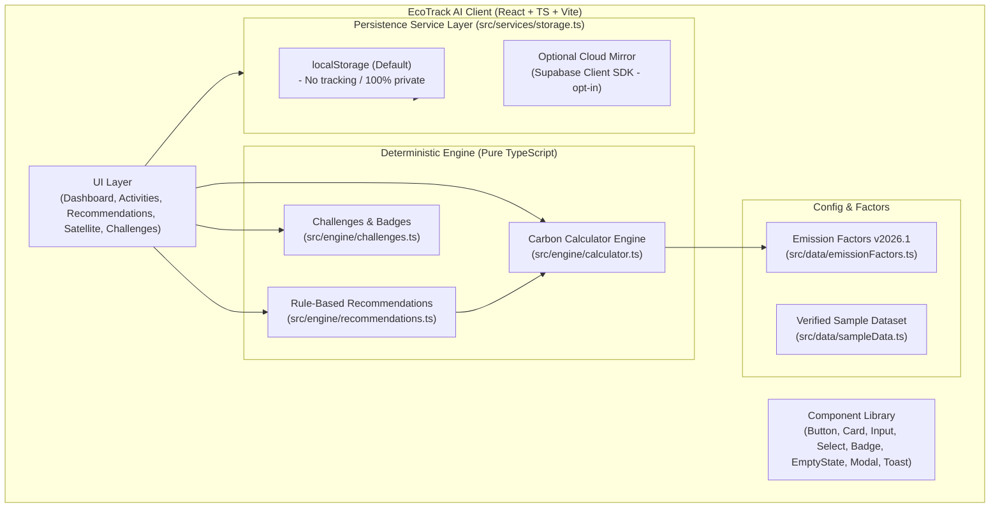

# EcoTrack AI

> **Tagline:** Your Activities. Your Carbon Footprint. Your Impact.  
> **Mission:** Measure Your Impact. Understand Your Footprint. Build a Greener Future.

**EcoTrack AI** is a modern, responsive, professional-grade personal carbon footprint tracking and reduction web application. Built with **React 18**, **TypeScript**, **Vite**, **Tailwind CSS**, **Recharts**, and **Leaflet (OpenStreetMap)**, EcoTrack AI operates completely in the browser with **zero backend processes to run manually**, zero authentication gates, and 100% transparent math.

---

## Architecture Overview



---

## Key Features

1. **Frictionless Welcome & 7-Step Onboarding**
   - No login, passwords, or account registration.
   - Autosave of every response to `localStorage` so onboarding survives browser refresh.
   - Calibrates lifestyle baseline: Commute, AC runtime, home lighting, household size allocation, and food/waste habits.
   - Generates initial baseline breakdown and 3 starter recommendations.
   - **One-Click Demo Mode:** Instant exploration with sample data (`Total: 2.4 kg CO2e; Transport: 1.8 kg; Electricity: 0.4 kg; Other: 0.2 kg`).

2. **Activity Ledger (`/activities`)**
   - Add, edit, and delete activities across **Transportation** (walking, cycling, two-wheeler, car, bus, train), **Electricity** (AC hours, lighting, appliances, or direct kWh), and **Waste & Lifestyle** (segregated waste, single-use plastic, composting, diet).
   - Live emissions computation preview with exact factor citation.
   - Distance warnings for daily travel above 500 km.
   - **On-Demand GPS Trip Tracker:** Calculates distance using the Haversine formula via `navigator.geolocation` only upon user request. Never runs in the background.
   - Deletion safety with confirmation dialog and **Undo Toast**.

3. **Carbon Dashboard (`/dashboard`)**
   - KPI Summary Cards: Lifetime emissions, today, this week, this month, reduction vs. baseline, and Eco Points.
   - **Recharts Data Visualizations:**
     - 7-Day daily stacked emissions chart.
     - This Week vs. Last Week comparative bar chart.
     - Category-wise donut share.
     - Target progress bar against user-configured monthly carbon ceiling.
   - Filter by date range, time view (weekly/monthly), and activity category.
   - Distinct "Sample data" badges on every chart when operating in Demo Mode.

4. **Rule-Based Recommendation Engine (`/recommendations`)**
   - 100% deterministic TypeScript logic (no external black-box LLM calls).
   - Priority ranking based on recorded activity patterns (car trip shifts, AC thermostat calibration, waste diversion, plant-rich meals).
   - User goals match weighting: goals selected during onboarding rank higher.
   - Extensible provider interface (`IRecommendationProvider`) prepared for future LLM integration.

5. **Gamification & Eco Challenges (`/challenges`)**
   - Daily micro-challenges and weekly conservation commitments.
   - Automatic activity evaluation (e.g. logging 1.5 km walk/cycle completes "Zero-Emission Short Trip").
   - Milestone Badges: *First Log*, *7-Day Streak*, *Car-Free Commuter*, *Plastic-Free Week*, *Halfway to Target*, *Grid Guardian*, *Eco Champion*.
   - Published Eco Points rules modal with celebratory confetti on achievement.

6. **Satellite Earth Insights (`/satellite`)**
   - Interactive **Leaflet map** rendered with OpenStreetMap tiles.
   - Multi-city context: Bengaluru Urban, Delhi NCR, Mumbai Metropolitan, Hyderabad Agglomeration.
   - Regional context indicators: Vegetation Index (NDVI), Forest & Tree Cover %, Urban Built-Up Density %, Surface Heat Anomaly (°C).
   - Mandatory disclaimer: *"This is regional context only. Your footprint is calculated from your own activity records."*

7. **How We Calculate (`/how-we-calculate`)**
   - Transparent directory listing every emission factor, value, unit, source institution (linked), year, and status (`measured` or `estimated`).
   - Explicit household allocation formula and domestic electricity engineering assumptions.

8. **Settings & Data Sovereignty (`/settings`)**
   - Edit all onboarding lifestyle parameters and regenerate baseline profile.
   - Set custom monthly reduction target (kg CO2e).
   - Manage browser permissions (Location, GPS tracking, Local storage). Turning off local storage clears activity records after confirmation.
   - **Data Portability:** Export full backup as JSON, export activities as CSV spreadsheet, and import JSON backups with validation.
   - Complete data reset behind safety confirmation.

---

## Verified Emission Factors

All emission factors are housed in [`src/data/emissionFactors.ts`](file:///d:/PSG%20@/src/data/emissionFactors.ts) (Version `2026.1`):

| Activity | Value | Unit | Status | Official Source |
| :--- | :--- | :--- | :--- | :--- |
| **Walking** | `0.000` | kg CO2e / km | Measured | IPCC Guidelines for National GHG Inventories |
| **Cycling** | `0.000` | kg CO2e / km | Measured | IPCC Guidelines for National GHG Inventories |
| **Two-Wheeler (100-150cc)** | `0.035` | kg CO2e / km | Estimated | Bureau of Energy Efficiency (BEE) & ARAI Indian Vehicle Baseline |
| **Personal Car (Petrol/Diesel)** | `0.140` | kg CO2e / km | Estimated | Centre for Energy, Environment and Water (CEEW) & MoRTH |
| **Public Bus (CNG/Diesel)** | `0.038` | kg CO2e / km | Estimated | The Energy and Resources Institute (TERI) Urban Mobility |
| **Metro / Electric Rail** | `0.025` | kg CO2e / km | Measured | Indian Railways Sustainability Directorate & BEE |
| **Grid Electricity (India)** | `0.716` | kg CO2 / kWh | Measured | Central Electricity Authority (CEA) CO2 Baseline Database v19 |
| **Air Conditioner (1.5T 3-Star)** | `0.859` | kg CO2e / hr | Estimated | BEE Star Rating Database & CEA Grid Factor (1.2 kW draw) |
| **Home Lighting (LED/CFL)** | `0.029` | kg CO2e / hr | Estimated | EESL UJALA Domestic Lighting Baseline (0.04 kW draw) |
| **Appliances Base Load** | `0.179` | kg CO2e / hr | Estimated | BEE Domestic Appliance Profiles (0.25 kW continuous) |
| **Mixed Landfill Waste** | `0.450` | kg CO2e / kg | Estimated | Central Pollution Control Board (CPCB) Solid Waste Baseline |
| **Segregated Processed Waste** | `0.150` | kg CO2e / kg | Estimated | CPCB & Swachh Bharat Urban Processing Metrics |
| **Composted Organics** | `0.050` | kg CO2e / kg | Estimated | IPCC Biological Treatment of Solid Waste |
| **Recycled Dry Waste** | `0.080` | kg CO2e / kg | Estimated | CPCB Extended Producer Responsibility (EPR) Life Cycle Data |
| **Single-Use Plastic Item** | `0.060` | kg CO2e / item| Estimated | UNEP Single-Use Plastics LCA & PWM Rules |

*Note: Shared domestic electricity and cooling are proportionally allocated by household size (`kWh / householdSize`), preventing double counting.*

---

## Getting Started

### Prerequisites
- [Node.js](https://nodejs.org/) (v18.0.0 or higher)
- npm (v9.0.0 or higher)

### Setup & Development

```bash
# 1. Install dependencies
npm install

# 2. Launch Vite development server
npm run dev
```

The app will be running at `http://localhost:5173`. No backend services, database migrations, or background daemons are required!

### Running Unit Tests

```bash
npm test
```

Runs the test suite using **Vitest** and **React Testing Library**:
- Calculator engine tests (household allocation, non-negative inputs, conversions).
- Recommendation engine trigger tests.
- Onboarding component tests (autosave, step navigation, validation).

### Production Build

```bash
npm run build
npm run preview
```

---

## Optional Cloud Persistence (Supabase)

EcoTrack AI functions completely without Supabase. If you wish to optionally mirror your activity ledger to a Supabase PostgreSQL instance:

1. Create a project at [supabase.com](https://supabase.com).
2. Create an `.env` file in the project root:
   ```env
   VITE_SUPABASE_URL=https://your-project-id.supabase.co
   VITE_SUPABASE_ANON_KEY=your-anon-public-key
   ```
3. Run `npm run dev`. When these environment variables are detected, [`src/services/supabase.ts`](file:///d:/PSG%20@/src/services/supabase.ts) enables background cloud mirroring while retaining localStorage as primary cache.

---

## Accessibility & Design Standards

- **Palette:** Calm green-and-slate (`eco-600` primary, `slate-900` dark neutral, with `amber-500` / `red-500` strictly reserved for high emissions or warnings).
- **Dark Mode:** System preference detection with manual toggle persisted in `localStorage`.
- **Contrast:** Strict WCAG AA compliance with visible `:focus-visible` keyboard focus rings.
- **Screen Reader Support:** Semantic HTML, ARIA attributes on modal dialogs, toggles, progress bars, and hidden text summaries (`.sr-only`) describing all Recharts data.
- **Motion:** Full support for `prefers-reduced-motion` media query.

---

## Known Limitations

- **Browser-Scoped Storage:** Because data is saved in `localStorage`, clearing browser data or browsing in Incognito mode will reset activities unless exported to JSON.
- **GPS Distance:** Geolocation distances are calculated via client-side GPS coordinates (Haversine formula). Urban GPS jitter is mitigated by accuracy filtering, but GPS distance remains an estimate compared to odometer readings.
- **Satellite Data:** Regional environmental indicators are derived from public Copernicus and NASA Earthdata raster overpasses. They provide macroeconomic context and do not measure personal emissions.

---

## License
MIT © 2026 EcoTrack AI. Open carbon accounting for conscious living.
